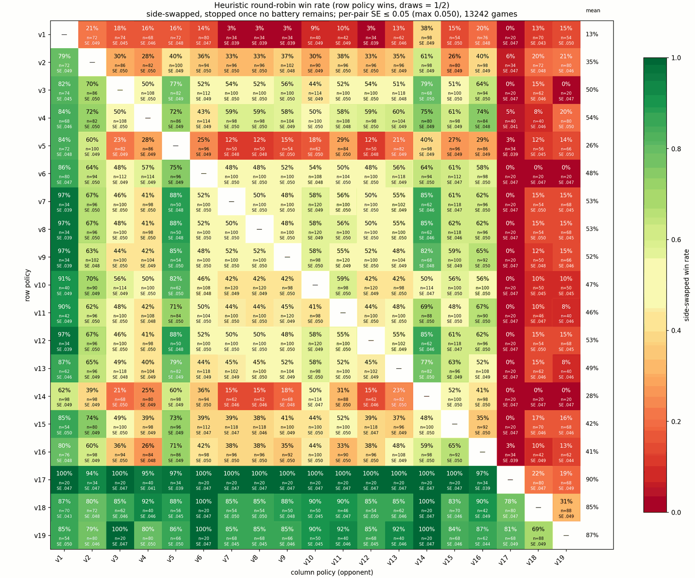
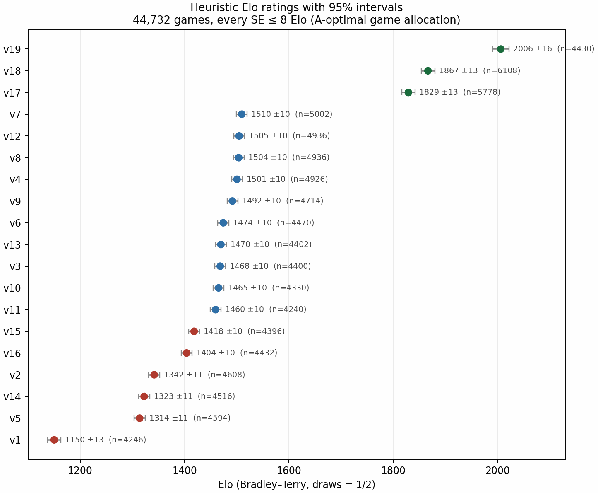

# 휴리스틱 V1–V19 전체 승률 매트릭스와 Elo — 2026-09-18

V1–V19 19개 정책(`strategic_v4_near` 제외)의 완전 라운드로빈 결과다. 총 **44,732경기**를 두 단계로
나눠 돌렸다. 1단계는 모든 쌍의 **승률 표준오차**를 같은 수준으로 맞추고(히트맵용), 2단계는 Elo
**평점 분산**을 가장 많이 줄이는 쌍에만 경기를 더 줬다(레이팅용). 두 목적은 예산 배분이 다르다.
100%–0% 쌍은 경기를 아무리 늘려도 Elo 정보가 거의 없기 때문이다.

모든 경기는 seed마다 양 진영을 한 번씩 플레이하는 paired 평가이고, 무승부는 0.5승으로 센다.

- 1단계 라운드로빈: `examples/tournament_adaptive.py` → `reports/heuristic_tournament_adaptive_se05_20260918/`
- 2단계 Elo 보강: `examples/elo_augment.py` → `reports/elo_augment_20260918/`
- Elo 진단(LOO): `examples/analyze_elo_diagnostics.py`

---

## 0. 한눈에 보기

1. **상위 3개는 v19 > v18 > v17로 확실히 갈린다.** 13k경기 시점에는 v18과 v17이 1801로 동률이었는데,
   경기를 늘리자 2006 / 1867 / 1829로 벌어졌다. 초기 동률은 실력이 아니라 불확실성이었다.
2. **v17은 Elo 1축 모델이 가장 못 맞추는 정책이다.** v1–v16 상대 95–100%인데 v18·v19에는 16–21%로 진다.
   경기를 5,778판까지 늘려도 LOO 평균 절대오차 10.0%로 여전히 최대다(13k 시점 14.8%).
3. **중위권 v3·v4·v6–v13은 사실상 구분되지 않는다.** 1460–1510, 즉 50 Elo 폭에 9개가 몰려 있다.
4. **v7·v8·v12는 거의 같은 정책이다.** 상호 대결이 모두 50%이고, 같은 시드에서 점수까지 일치한다
   (v5·v19 상대로는 경기별 점수가 완전히 동일, v1·v14 상대로만 갈린다).
5. **하위권은 v1(1150)이 압도적 최하위**이고 v5·v14·v2가 그 위다.
6. **경기는 배터리가 떨어지면 끝난다.** 배터리가 맵·창고·유닛 어디에도 없으면 점수가 고정되므로 조기
   판정했고, 전체의 **50.1%(22,430경기)**가 이 조건으로 종료됐다. 평균 경기 길이 1,340결정(420초 = 10,500결정).



---

## 1. Elo 레이팅 (44,732경기, 모든 SE ≤ 8)

Bradley–Terry 적합, 무승부 0.5승, 평균 1500 중심. 괄호는 95% 구간 폭.

| 정책 | Elo | ±95% | 경기 수 | | 정책 | Elo | ±95% | 경기 수 |
|---|---:|---:|---:|---|---|---:|---:|---:|
| v19 | **2006** | ±16 | 4,430 | | v13 | 1470 | ±10 | 4,402 |
| v18 | **1867** | ±13 | 6,108 | | v3 | 1468 | ±10 | 4,400 |
| v17 | **1829** | ±13 | 5,778 | | v10 | 1465 | ±10 | 4,330 |
| v7 | 1510 | ±10 | 5,002 | | v11 | 1460 | ±10 | 4,240 |
| v12 | 1505 | ±10 | 4,936 | | v15 | 1418 | ±10 | 4,396 |
| v8 | 1504 | ±10 | 4,936 | | v16 | 1404 | ±10 | 4,432 |
| v4 | 1501 | ±10 | 4,926 | | v2 | 1342 | ±11 | 4,608 |
| v9 | 1492 | ±10 | 4,714 | | v14 | 1323 | ±11 | 4,516 |
| v6 | 1474 | ±10 | 4,470 | | v5 | 1314 | ±11 | 4,594 |
| | | | | | v1 | 1150 | ±13 | 4,246 |



상위 3개 상호 전적(승률은 행 기준):

| 대결 | 승률 | W-L-D |
|---|---:|---|
| v19 vs v18 | 69.3% | 972-430-0 |
| v19 vs v17 | 84.2% | 1140-214-0 |
| v18 vs v17 | 79.3% | 541-141-0 |

---

## 2. 왜 두 단계로 나눴나

**1단계 — 쌍별 승률 SE 균등화 (13,244경기).** 히트맵의 모든 칸을 같은 신뢰도로 읽으려면 쌍마다 목표
SE에 도달할 때까지만 경기를 주면 된다. 쌍당 5시드(10경기)에서 시작해 SE > 0.05면 시드를 추가했고,
일방적인 쌍은 20경기에서 멈추고 접전 쌍만 120경기까지 갔다. 171쌍 전부 SE ≤ 0.05.

SE는 두 추정치의 최댓값을 쓴다. 하나는 시드별 양진영 평균을 표본으로 한 paired SE, 다른 하나는
Laplace 보정 이항 SE `sqrt(p(1-p)/n)`, `p = (점수+1)/(n+2)`다. 10-0 같은 표본에서 paired SE가 0으로
나오는 것을 막기 위한 하한이며, 이 하한 때문에 최소 경기 수가 사실상 20판이 된다.

**2단계 — Elo 분산 기준 배분 (31,488경기 추가).** Elo에서 쌍 (i,j)의 Fisher 정보는 `n·p(1-p)`라서
p가 0이나 1에 가까우면 경기를 늘려도 평점이 안 좁아진다. 그래서 `elo_active.choose_pairs`의 A-optimal
greedy(Sherman–Morrison으로 평점 분산 합 감소량 최대인 쌍 선택)로 쌍을 골라 SE ≤ 8 Elo까지 돌렸다.
경기는 대부분 v17 관련 대결과 v18–v19에 갔고, 결과적으로 최대 SE 19.4 → 8.0, 평균 10.6 → 5.7.

비용은 `1/SE²`로 늘어난다. 실측 기준 SE 19.4 → 8까지 31,488경기(3시간 9분)가 들었고, 여기서 SE 5까지 더 가려면 약 67,000경기가 추가로 필요하다.

---

## 3. 조기 판정 규칙 (경기 시간 3배 단축)

배터리는 시작 시 한 번만 생성되고 재생성되지 않으며, 점수를 주는 아이템은 배터리뿐이다. 따라서
**맵 타일(창고 포함, graphic 채널 8)·유닛 소지(agent_states 4열) 어디에도 배터리가 없으면** 이후
점수가 변할 수 없다. 이 시점에 경기를 끝내고 점수가 높은 팀을 승자로 판정한다(동점은 무승부).

420초 완주하던 경기 28판으로 검증했다:

- 28판 모두 배터리 소진 시점이 존재했고 평균 1,680결정(약 67초)에서 도달했다.
- 그 이후 점수가 바뀐 경기는 0판.
- 소진 시점의 점수 우위 팀 = Unity 최종 승자, 28/28 일치.
- 소진이 흡수 직후에만 오는 것은 아니다(흡수 잔여시간 0.26–0.72 구간에서 도달한 경기 존재). 그래도
  점수는 고정이므로 조건 자체로 판정한다.

효과: 평균 경기 길이가 줄어 처리량이 약 0.9 → 3 경기/초로 올랐다(18 워커, headless, `time_scale=20`).
`time_scale`은 20 이상에서 의미가 없다 — 병목이 시뮬레이션 속도가 아니라 ML-Agents 스텝당 왕복(~6ms)이다
(`perf_experiments_20260913.md`).

---

## 4. 해석할 때 주의할 점

- **v17의 절대 수치는 믿지 말 것.** 1축 Elo는 "v1–v16은 학살하지만 v18·v19에는 진다"를 표현할 수 없어
  v17 평점이 압축된다. LOO 적합은 v17이 v18을 65% 이긴다고 예측하지만 실제는 21%다. 순위(v19 > v18 > v17)는
  믿을 수 있고, 값 자체는 편향돼 있다.
- **0% 칸은 하한이 아니라 상한이 눌린 값이다.** v6 vs v18/v19, v3 vs v19 등 0-20 기록을 Elo는 5–17%로
  올려 예측한다. 실제 격차는 표보다 크다.
- **중위권 순위는 노이즈다.** v7/v12/v8/v4/v9의 1492–1510 차이는 95% 구간(±10)이 겹친다.
- **v7·v8·v12 중복 확인 필요.** 같은 정책이 세 이름으로 등록돼 있다면 mixture 가중치와 데이터 다양성이
  의도와 다르게 계산된다.

---

## 5. 재현

```bash
# 1단계: 쌍별 SE 0.05까지 라운드로빈 (13,244경기, ~64분, 18워커)
./.venv/bin/python examples/tournament_adaptive.py --workers 18 --target-se 0.05 \
    --min-seeds 5 --max-seeds 60 --output reports/heuristic_tournament_adaptive_se05_20260918

# 2단계: Elo SE 8까지 A-optimal 보강 (31,488경기, ~3시간 10분)
./.venv/bin/python examples/elo_augment.py --workers 18 --target-se 8 \
    --pairs-per-round 24 --per-policy 4 \
    --prior reports/heuristic_tournament_adaptive_se05_20260918/games.jsonl \
    --output reports/elo_augment_20260918

# LOO 진단 (combined_tournament.json은 두 단계 경기를 쌍별로 합친 것)
./.venv/bin/python examples/analyze_elo_diagnostics.py \
    reports/elo_augment_20260918/combined_tournament.json
```

두 스크립트 모두 같은 `--output`으로 다시 실행하면 이어서 진행한다(`games.jsonl` 기준 resume).
